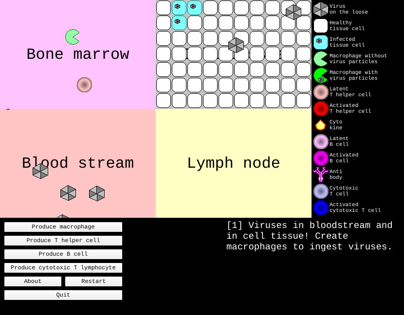

# SimImmuneResponse

Branch|[](https://travis-ci.org)
---|---
`master`|[](https://travis-ci.org/richelbilderbeek/SimImmuneResponse)

Educational simulation of the human immune response using C++ and Qt.

Originally written in 2008 using the C++ VCL library (C++ Builder);
the VCL version can be found in the Git history.



## Build

Requires a C++17 compiler and Qt 5 (Qt Widgets), e.g. on Debian/Ubuntu:

```
sudo apt install qtbase5-dev qt5-qmake
qmake SimImmuneResponse.pro
make
./SimImmuneResponse
```

To run the tests:

```
qmake SimImmuneResponseTest.pro
make
./SimImmuneResponseTest
```

## Material

 * Download the Dutch lesson material: [doc](doc/TeachSimImmuneResponse.doc), [odt](doc/TeachSimImmuneResponse.odt), [pdf](doc/TeachSimImmuneResponse.pdf)
 * [Download the Windows executable](http://richelbilderbeek.nl/ToolSimImmuneResponseExe.zip)
 * Video's: [YouTube](https://youtu.be/nNvr51psO_0) [.ogv](http://richelbilderbeek.nl/sim_immune_response.ogv)
 * Download the Dutch evaluation material: [doc](doc/TeachTestSimImmuneResponse.doc), [odt](doc/TeachTestSimImmuneResponse.odt), [pdf](doc/TeachTestSimImmuneResponse.pdf)
