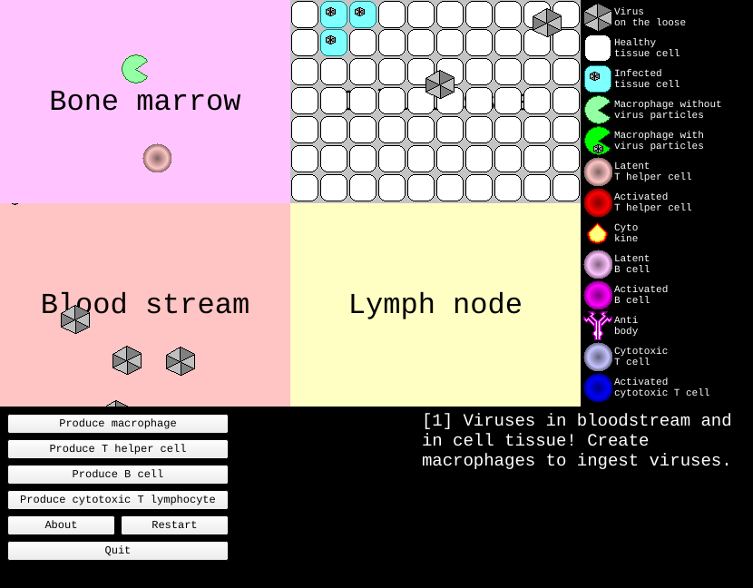

# SimImmuneResponse

SimImmuneResponse is an educational simulation of the human immune response.

A virus has entered the body.
You play the immune system:
produce immune cells in the bone marrow
and drag them to the right place in the body,
to get rid of the virus before it has infected all cells.

The body is shown as four locations:

Location     |Description
-------------|---------------------------------------------------------
Bone marrow  |Where new immune cells are produced
Cell tissue  |The tissue cells that the virus wants to infect
Blood stream |Where viruses, antibodies and cytokines travel through
Lymph node   |Where immune cells meet and get activated

## Where to go next

- [How to play](playing.md): the cells and the steps of the immune response
- [Lesson material](lesson_material.md): Dutch lesson and test material
- [Building](building.md): how to build and run the simulation
- [History](history.md): the original 2008 version

## Video

- [Watch SimImmuneResponse on YouTube](https://youtu.be/nNvr51psO_0)

## License

SimImmuneResponse is free software,
licensed under the
[GNU General Public License version 3](https://github.com/richelbilderbeek/SimImmuneResponse/blob/master/LICENSE).
