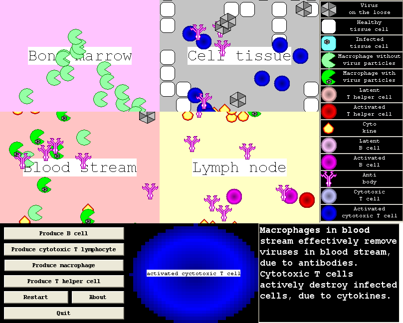

# History

SimImmuneResponse was programmed by Richel Bilderbeek
in April and May 2008,
in C++ using C++ Builder and its VCL library.
It ran on Microsoft Windows only.

In 2026, SimImmuneResponse was ported to Qt,
so that it runs on Linux, macOS and Windows.
The simulation itself has been kept the same.
The VCL version can be found in the
[Git history](https://github.com/richelbilderbeek/SimImmuneResponse/commits/master).
