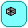

# How to play

At the start, viruses are in the blood stream
and will soon infect the healthy cells in the cell tissue.
An infected cell will burst after a while, releasing new viruses.
When no healthy cells are left, the organism dies.

Use the buttons to produce immune cells.
New cells appear in the bone marrow.
Drag a cell with the mouse to move it to another location.
Viruses, antibodies, cytokines and tissue cells cannot be dragged.

The feedback panel at the bottom-right tells you what to do next.

## The cells

Picture                                                                 |Cell                              |What it does
------------------------------------------------------------------------|----------------------------------|-----------------------------------------------------------
                                          |Virus                             |Infects healthy tissue cells
                            |Healthy tissue cell               |Can be infected by a virus
                          |Infected tissue cell              |Bursts after a while, releasing three new viruses
        |Macrophage without virus particles|Ingests a virus in the blood stream
|Macrophage with virus particles   |Activates T helper cells; with antibodies, destroys viruses
                           |Latent T helper cell              |Is activated by a macrophage with virus particles
       |Activated T helper cell           |Produces cytokines in the lymph node
                                    |Cytokine                          |Activates B cells and cytotoxic T cells
                                         |Latent B cell                     |Is activated by a cytokine
                     |Activated B cell                  |Produces antibodies in the lymph node
                                    |Antibody                          |Helps macrophages to destroy viruses in the blood stream
                     |Cytotoxic T cell                  |Is activated by a cytokine
 |Activated cytotoxic T cell        |Destroys infected tissue cells

## The steps to immunity

1. Produce a macrophage and drag it to the blood stream,
   on top of a virus, to let it ingest the virus
2. Drag the macrophage with virus particles to the lymph node
3. Produce a T helper cell and drag it to the lymph node,
   on top of the macrophage, to activate it.
   The activated T helper cell starts producing cytokines
4. Produce a B cell and drag it to the lymph node,
   on top of a cytokine, to activate it.
   The activated B cell starts producing antibodies:
   this is the humoral response
5. Antibodies and cytokines flow from the lymph node
   to the blood stream and the cell tissue.
   Send macrophages to the blood stream:
   with the help of the antibodies, they destroy all viruses
6. Produce a cytotoxic T cell, activate it with a cytokine
   and drag it to the cell tissue.
   It destroys the infected cells: this is the cellular response

When all viruses are gone, the organism has acquired immunity.
